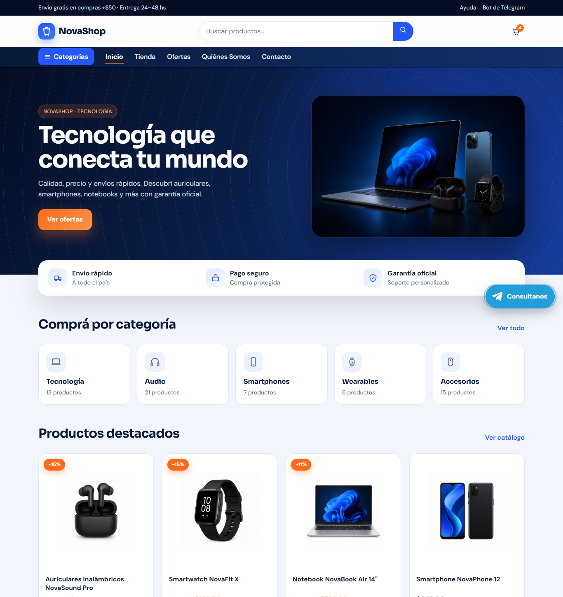
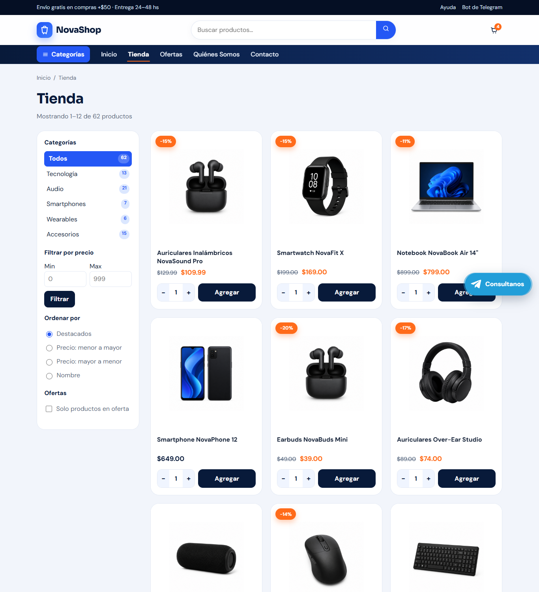
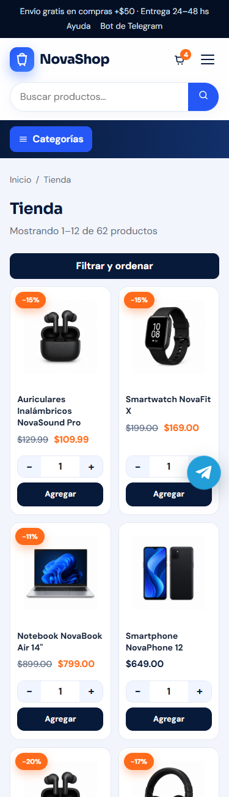

# NovaShop

Tienda online de tecnología con un bot de Telegram que atiende las consultas de los clientes.

Trabajo Práctico N° 4 - Práctica Profesionalizante II
Alumno: Steve Brusa

- **Sitio publicado:** https://novashop-bot.vercel.app
- **Bot de Telegram:** https://t.me/NovaShopsjTienda_bot



## Qué es

NovaShop es una tienda de tecnología (auriculares, notebooks, smartphones, accesorios). El proyecto tiene dos partes que trabajan juntas:

1. **La tienda web**: catálogo con filtros, ficha de producto, carrito, checkout, contacto y quiénes somos.
2. **El bot**: responde consultas sobre productos, precios, ofertas, envíos, pagos y garantía. Se puede usar desde Telegram o desde el chat de la misma página (botón **Consultanos**, abajo a la derecha), y además le avisa al dueño de la tienda cuando entra un pedido o una consulta desde la web.

Las dos partes usan el mismo catálogo (`data/productos.json`), así que si se cambia un precio se actualiza en la tienda y en el bot al mismo tiempo.

El proyecto nació como un tema de WordPress + WooCommerce (está en la carpeta `wordpress/`). Para poder publicarlo en Vercel, que no corre PHP ni MySQL, se pasó la tienda a HTML, CSS y JavaScript manteniendo el mismo diseño.

## Funcionamiento de la tienda

| Página | Archivo | Qué hace |
|--------|---------|----------|
| Inicio | `index.html` | Presentación, beneficios y productos destacados |
| Tienda | `tienda.html` | Catálogo de 62 productos con filtro por categoría, precio y ofertas, buscador, orden y páginas |
| Producto | `producto.html` | Ficha del producto, cantidad y agregar al carrito |
| Carrito | `carrito.html` | Cambiar cantidades, quitar productos, subtotal, envío y total |
| Checkout | `checkout.html` | Datos del cliente y confirmación del pedido |
| Contacto | `contacto.html` | Formulario de consultas |
| Quiénes Somos | `quienes-somos.html` | Página institucional |
| Bot | `bot.html` | Cómo usar el bot y lista de comandos |

- El carrito se guarda en el navegador (localStorage), no se pierde al cambiar de página.
- El envío es gratis en compras de más de $50; si no, cuesta $5.
- Cuando se confirma un pedido o se envía el formulario de contacto, la web llama a `/api/aviso` y el bot le manda el detalle por Telegram al dueño de la tienda.
- El sitio es responsive: se adapta a celular, tablet y escritorio.

| Tienda | Celular |
|--------|---------|
|  |  |

## Funcionamiento del bot

El bot está hecho en Python, con la estructura que se vio en clase: `main.py` recibe los mensajes y `responses.py` arma las respuestas. La lógica está adaptada al negocio de la tienda.

| Comando | Respuesta |
|---------|-----------|
| `/start` | Bienvenida y lista de comandos |
| `/help` | Ayuda |
| `/productos` | Resumen del catálogo por categoría |
| `/categorias` | Categorías y cantidad de productos |
| `/ofertas` | Las 10 ofertas con más descuento |
| `/destacados` | Productos destacados |
| `/buscar teclado` | Busca un producto por nombre |
| `/hasta 100` | Productos que se pueden comprar con ese monto |
| `/recomendar` | Recomienda los productos más elegidos |
| `/envios` | Costo y tiempo de envío |
| `/pagos` | Medios de pago |
| `/garantia` | Garantía y cambios |
| `/stock` | Disponibilidad de los productos |
| `/seguimiento` | Cómo seguir un pedido |
| `/contacto` | Horarios de atención |
| `/miid` | Muestra el id del chat (lo usa el dueño para recibir los pedidos) |

También entiende texto libre. Estas son las respuestas que tiene:

| # | Tema | Ejemplo de mensaje | Qué responde |
|---|------|--------------------|--------------|
| 1 | Producto | `cuanto sale el teclado 60?` | Ficha con precio, descripción y link para comprarlo |
| 2 | Varios productos | `auriculares` | Lista de los que coinciden, ordenados por precio |
| 3 | Categoría | `audio` | Productos de esa categoría |
| 4 | Presupuesto | `auriculares hasta 80` | Productos que entran en ese monto |
| 5 | Más barato / más caro | `cual es el mouse mas barato` | El producto más económico o el más caro |
| 6 | Ofertas | `tienen descuentos?` | Las 10 ofertas con más descuento |
| 7 | Catálogo | `que venden` | Resumen por categoría |
| 8 | Recomendación | `que me recomendas para regalar` | Productos destacados |
| 9 | Envíos | `hacen envios a san juan?` | Costo y tiempo de envío |
| 10 | Pagos | `puedo pagar con tarjeta?` | Medios de pago |
| 11 | Garantía | `y si viene fallado?` | Garantía y cambios |
| 12 | Stock | `hay stock?` | Disponibilidad y despacho |
| 13 | Seguimiento | `donde esta mi pedido` | Cómo seguir el envío |
| 14 | Cómo comprar | `quiero comprar` | Pasos y link a la tienda |
| 15 | Ubicación | `tienen local?` | Tienda online, envíos a todo el país |
| 16 | Atención | `quiero hablar con una persona` | Formulario de contacto y horarios |
| 17 | Sobre la tienda | `que es novashop` | Presentación y link a Quiénes Somos |
| 18 | Saludo | `hola` | Bienvenida |
| 19 | Agradecimiento | `gracias` | Respuesta de cortesía |
| 20 | Despedida | `chau` | Despedida |
| 21 | No entendido | `asdf` | Pide que reformule y sugiere `/start` |

### Cómo funciona por dentro

```
Cliente en Telegram ──► Telegram ──► /api/webhook (Vercel) ──► responses.py ──► respuesta al cliente
Cliente en la web   ──► chat de la página ──► /api/chat (Vercel) ──► responses.py ──► respuesta en el chat
Cliente en la web   ──► checkout / contacto ──► /api/aviso (Vercel) ──► mensaje al dueño por Telegram
```

- En la PC el bot corre con `main.py` usando *polling* (el programa le pregunta a Telegram si hay mensajes nuevos).
- En Vercel no puede quedar un programa corriendo todo el tiempo, por eso se usa un *webhook*: Telegram llama a `/api/webhook` cada vez que alguien escribe. Las respuestas salen del mismo `responses.py`.

## Estructura del repositorio

```
├── index.html, tienda.html, producto.html, carrito.html,
│   checkout.html, contacto.html, quienes-somos.html, bot.html
├── assets/
│   ├── css/main.css        estilos del tema NovaShop
│   ├── css/tienda.css      carrito, checkout y ajustes responsive
│   ├── js/tienda.js        catálogo, filtros, carrito y checkout
│   ├── js/chat.js          chat del bot dentro de la página
│   └── img/                imágenes de los productos
├── data/productos.json     catálogo (lo usan la tienda y el bot)
├── bot/
│   ├── main.py             bot para correr en la PC
│   ├── responses.py        respuestas del bot
│   ├── set_webhook.py      conecta el bot con Vercel
│   └── requirements.txt
├── api/
│   ├── webhook.py          recibe los mensajes de Telegram en Vercel
│   ├── chat.py             responde los mensajes del chat de la página
│   └── aviso.py            avisa pedidos y consultas al dueño
├── wordpress/              versión original: tema de WordPress + WooCommerce
├── servidor_local.py       para probar la tienda con el chat en la PC
└── vercel.json
```

## Tecnologías

- HTML, CSS y JavaScript (sin frameworks)
- Python 3.12 y la librería `python-telegram-bot`
- API de bots de Telegram
- Vercel (sitio estático + funciones en Python)
- Git y GitHub

## Cómo probarlo en la PC

### Tienda

```bash
python servidor_local.py
```

Y abrir http://localhost:8000 (con este servidor también funciona el chat del bot).

### Bot

1. Crear el bot en Telegram hablando con [@BotFather](https://t.me/BotFather) (`/newbot`) y copiar el token.
2. Instalar la librería:

```bash
cd bot
python -m venv entorno
entorno\Scripts\activate
pip install -r requirements.txt
```

3. Copiar `.env.example` como `.env` y pegar el token en `TELEGRAM_TOKEN`.
4. Correr el bot:

```bash
python main.py
```

## Despliegue en Vercel

1. En [vercel.com](https://vercel.com) elegir **Add New → Project** e importar este repositorio. No hace falta cambiar ninguna opción.
2. En **Settings → Environment Variables** cargar:

| Variable | Valor |
|----------|-------|
| `TELEGRAM_TOKEN` | El token que da BotFather |
| `SITE_URL` | La dirección del sitio en Vercel |
| `ADMIN_CHAT_ID` | El número que responde el bot al comando `/miid` (opcional, para recibir los pedidos) |

3. Volver a desplegar (**Deployments → Redeploy**) para que tome las variables.
4. Conectar el bot con Vercel (una sola vez):

```bash
cd bot
python set_webhook.py https://novashop-bot.vercel.app
```

El token nunca se sube al repositorio: está en el archivo `.env` (ignorado por git) y en las variables de entorno de Vercel.

## Versión WordPress

En `wordpress/` está el tema original de NovaShop para WordPress + WooCommerce, con su documentación (`DOCUMENTACION.md`) y la guía de instalación (`INSTALACION.md`).
